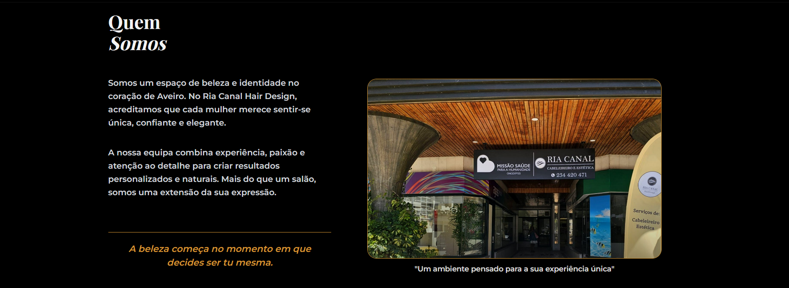

# Ria Canal Hair Design

Site institucional do salão **Ria Canal Hair Design**.

- **Live (principal):** https://www.riacanalhairdesign.pt/
- **Live (alternativo):** https://riacanalhairdesign.pt
- **Repo:** https://github.com/JoaoMiguelCosta/RiaCanalHairDesign

## 📸 Screenshots

### Homepage


### Portfólio


### O Espaço


### Before & After

---

## 📦 Stack

- React 18 + Vite
- CSS Modules
- React Router (base simples; pronto para evoluir)
- ESLint
- Node 18+

## 🚀 Scripts

```bash
# instalar deps
npm install

# dev server
npm run dev

# build de produção
npm run build

# preview do build local
npm run preview

# opcional: lint
npm run lint
```

## ✨ Funcionalidades

- Layout responsivo (desktop/tablet/mobile)
- Header com menus Desktop/Mobile, submenus e redes sociais
- Hero destacado
- Portfolio com tabs (`usePortfolioTabs`)
- Secção **Space** com vídeo/hover (`useHoverVideo`)
- Team & Services com CTA para o portfolio
- Testimonials com carousel automático (`useAutoCarousel`)
- Instagram (hook + componente)
- Contact com cartões de informação/chegada/métricas
- Footer com contactos, links, social e legal (`useOpenExternal`)

## 🗂️ Estrutura

```
.
├─ public/
├─ src/
│  ├─ app/
│  ├─ content/
│  │  ├─ contact/
│  │  ├─ footer/
│  │  ├─ gallery/
│  │  ├─ hero/
│  │  ├─ instagram/
│  │  ├─ legal/
│  │  ├─ media/
│  │  │  ├─ beforeAndAfter/
│  │  │  ├─ entrance/
│  │  │  ├─ hero/
│  │  │  ├─ space/
│  │  │  ├─ team/
│  │  │  ├─ videos/
│  │  │  └─ works/
│  │  ├─ navigation/
│  │  ├─ portfolio/
│  │  ├─ services/
│  │  ├─ social/
│  │  ├─ space/
│  │  ├─ teamMembers/
│  │  └─ testimonials/
│  ├─ pages/
│  ├─ shared/
│  │  ├─ assets/
│  │  └─ ui/
│  │     ├─ button/
│  │     ├─ icons/
│  │     ├─ logo/
│  │     ├─ pageLoader/
│  │     ├─ professionalPhoto/
│  │     ├─ quote/
│  │     ├─ serviceItem/
│  │     ├─ signatureMark/
│  │     ├─ statCard/
│  │     ├─ subtitle/
│  │     ├─ tagLine/
│  │     ├─ text/
│  │     ├─ title/
│  │     ├─ titleCaption/
│  │     └─ titleDescription/
│  └─ widgets/
│     ├─ aboutUs/
│     ├─ beforeAndAfter/
│     │  ├─ hook/
│     │  ├─ parts/
│     │  └─ ui/
│     ├─ contact/
│     │  ├─ parts/
│     │  └─ ui/
│     ├─ footer/
│     │  ├─ hook/
│     │  ├─ parts/
│     │  └─ ui/
│     ├─ header/
│     │  ├─ hook/
│     │  ├─ parts/
│     │  └─ ui/
│     ├─ hero/
│     │  ├─ ui/
│     │  ├─ hero.jsx
│     │  └─ hero.module.css
│     ├─ instagram/
│     │  ├─ hook/
│     │  └─ ui/
│     ├─ portfolio/
│     │  ├─ hook/
│     │  └─ ui/
│     ├─ space/
│     ├─ teamAndServices/
│     └─ testimonials/
├─ .gitignore
├─ eslint.config.js
├─ index.html
├─ package.json
├─ README.md
├─ vercel.json
└─ vite.config.js
```

**Resumo rápido da organização**

- **widgets/**: secções da página. Cada secção isola **ui** (apresentação), **hook** (lógica local) e **parts** (subcomponentes). O **hero** expõe também `hero.jsx` e `hero.module.css` no nível da secção.
- **content/**: "CMS lite" com textos/JSON e media. Subpastas temáticas (navegação, serviços, equipa, etc.) e `media/` para imagens/vídeos por área.
- **shared/ui/**: componentes reutilizáveis (botões, ícones, tipografia, cartões, loaders, etc.).
- **app/** e **pages/**: bootstrap e (se usado) rotas simples.
- **public/**: estáticos públicos.

### Aliases de import

Configurados no `vite.config.js` (ex.):

```js
import { defineConfig } from "vite";
import react from "@vitejs/plugin-react";
import path from "path";

export default defineConfig({
  plugins: [react()],
  resolve: {
    alias: {
      "@shared": path.resolve(__dirname, "src/shared"),
      "@widgets": path.resolve(__dirname, "src/widgets"),
      "@content": path.resolve(__dirname, "src/content"),
    },
  },
});
```

## 🧭 Navegação

SPA simples por secções/âncoras. Pode integrar **React Router** sem impacto na estrutura atual.

## 📑 Conteúdos rápidos

- Redes/links: `src/content/navigation/` (JSON)
- Legal: `src/content/legal/` (Termos e Privacidade)
- Imagens/Vídeos: `src/content/media/`

## ♿ Acessibilidade (base)

- Labels nos ícones/menus (ex.: `aria-label`)
- Foco visível (`:focus-visible`)
- Transições leves, contraste aceitável

## 🔐 Termos e Privacidade

- Termos de Utilização: [https://ria-canal-hair-design.vercel.app/termos](https://ria-canal-hair-design.vercel.app/termos)
- Política de Privacidade: [https://ria-canal-hair-design.vercel.app/privacidade](https://ria-canal-hair-design.vercel.app/privacidade)

## 🏗️ Arquitetura

- Tipo: SPA estática (React + Vite), sem backend
- Build: gerado para `dist/` e servido via Vercel (CDN e cache por ficheiro)
- Princípios

  - Composição > herança; Single Responsibility por componente
  - UI desacoplada de lógica: hooks encapsulam comportamento; `ui/` é declarativo
  - Estilos isolados com CSS Modules (sem poluição global)
  - Data flow unidirecional: props descem; eventos sobem

## ⚡ Performance

- Build otimizado pelo Vite (ESM)
- Code splitting nativo
- Imagens e media versionadas
- Assets servidos pela CDN da Vercel

## 🧪 Testabilidade/Manutenção

- Componentes pequenos e puros facilitam testes unitários
- Widgets substituíveis sem efeito colateral
- Conteúdos em `src/content/` → menor necessidade de tocar em código

## 🚀 Deploy (Vercel)

- Build: `npm run build`
- Output: `dist/`
- Deploy automático em push para `main`

### SEO, routing e URLs públicos

- **HTML inicial por rota (sem SSR):** o plugin `scripts/routeDocuments.js`
  gera no build `index.html`, `termos.html`, `privacidade.html` e `404.html`
  a partir do mesmo `index.html` processado pelo Vite (mesmos JS/CSS com
  hash); só muda o bloco de metadados (title, description, canonical, Open
  Graph, Twitter e, na Home, JSON-LD `HairSalon`).
- **Fonte única dos metadados:** `src/app/seo/routeMeta.js`. Na navegação
  SPA, `syncHead.js` atualiza as mesmas tags (sem duplicados).
- **Política de URLs:** domínio `https://www.riacanalhairdesign.pt`;
  caminhos em minúsculas, sem barra final (exceto `/`) e sem `.html`.
  - `/termos/` → `308 /termos` (`trailingSlash: false`, query preservada)
  - `/termos.html` → `308 /termos` (`cleanUrls: true`)
  - maiúsculas (`/Termos`) → `404` (rotas `caseSensitive`)
  - URL desconhecido ou asset inexistente → `404.html` com HTTP 404 (`noindex`)
  - fragmentos (`/#Location`) não chegam ao servidor e não são alterados
- **`vercel.json`:** sem rewrite catch-all (impediria o `404.html`); cache
  imutável apenas em `/assets/*` (nomes com hash).
- **Domínio:** o redirect apex → `www` é configurado no dashboard da Vercel
  (Domains), não no `vercel.json`; deve ser permanente (308).
- `npm run preview` emula localmente estas regras estáticas; a confirmação
  dos códigos HTTP reais exige um Preview Deploy.


## 🤝 Contribuição

- Branch: `feat/<nome>`
- Commits curtos e claros
- PR para `main`


---

> Tipo: **SPA estática** (React + Vite). Sem chamadas a API. Pronta para evoluir com roteamento e mais conteúdos sem alterar a organização atual.
