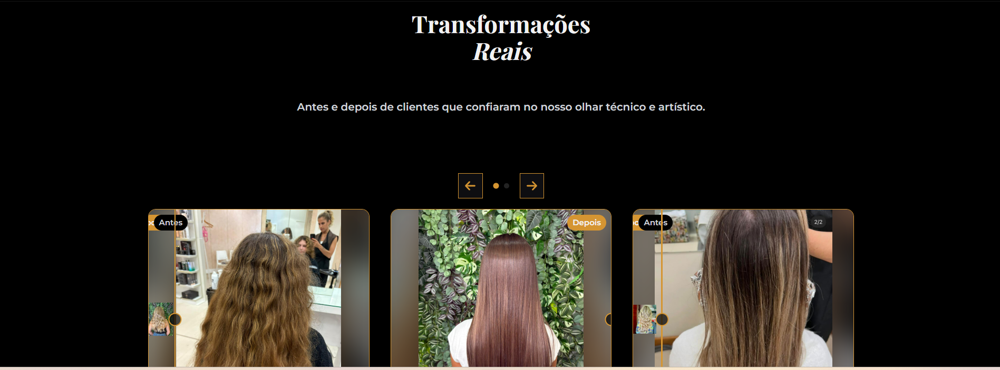

# Ria Canal Hair Design

Site institucional do salão **Ria Canal Hair Design**.

- **Produção:** https://www.riacanalhairdesign.pt/ (o domínio sem `www` redireciona para aqui)
- **Repo:** https://github.com/JoaoMiguelCosta/RiaCanalHairDesign

## 📸 Screenshots

### Homepage


### Portfólio


### O Espaço


### Before & After


---

## 📦 Stack

- React 19, React Router 7, Vite 7, JavaScript/JSX, CSS Modules
- Vitest + React Testing Library (jsdom), Playwright + axe-core
- ESLint 9
- SPA estática servida pela Vercel (sem backend, sem SSR)

## ⚙️ Requisitos

| Ferramenta | Versão | Onde está definida |
| --- | --- | --- |
| Node.js | **24.x (LTS)** | `package.json` → `engines.node` (lido também pela Vercel e pela CI) |
| npm | 11 (incluído no Node 24) | `package.json` → `packageManager` |

A Vercel usa `engines.node` em vez da versão escolhida nas definições do
projeto. Node 20 chegou ao fim de vida em abril de 2026.

## 🚀 Comandos

```bash
npm ci                      # instala exatamente o package-lock.json
npm run dev                 # servidor de desenvolvimento (Vite)
npm run build               # build de produção em dist/
npm run preview             # serve o dist/ com as regras estáticas da Vercel emuladas
npm run lint                # ESLint
```

### Testes

```bash
npm run test:run            # unitários e integração (Vitest, jsdom), uma vez
npm test                    # Vitest em modo watch
npm run test:coverage       # cobertura em coverage/

npm run test:e2e:install    # 1.ª vez: Chromium do Playwright
npm run test:e2e:install:all  # Chromium, Firefox e WebKit
npm run test:e2e            # E2E em Chromium + testes visuais
npm run test:e2e:cross      # E2E em Firefox e WebKit
npm run test:e2e:all        # todos os projetos Playwright

npm run test:all            # lint → unitários → E2E (Chromium + visuais)
```

O Playwright faz o build e arranca o `vite preview` (porta 4318) sozinho; os
E2E bloqueiam a rede externa e falham com erros JavaScript na página.
Detalhes, convenções e limitações: [tests/README.md](tests/README.md).

### Vários browsers

| Projeto Playwright | Motor | O que corre |
| --- | --- | --- |
| `chromium` | Chromium | suite funcional completa |
| `chromium-visual` | Chromium | só `visual.spec.js` (baselines por SO) |
| `firefox` | Firefox | suite funcional, exceto `buildOutput.spec.js` (não usa browser) e os 2 gestos de toque via CDP |
| `webkit` | WebKit | idem, e ainda sem os 2 testes de ordem de `Tab` entre links nem o que interceta o MP3 com `page.route` |

Os 4 testes com preferências reais de letra (texto ampliado) só correm no
`firefox`, o único motor onde se configuram.

Os testes saltados indicam o motivo no relatório (`test.skip`); os detalhes
estão em [tests/README.md](tests/README.md#limitações-conhecidas). WebKit do
Playwright não é o Safari de um iPhone: a emulação móvel (viewport, toque,
`isMobile`) não substitui um teste em hardware real.

### Testes visuais

As baselines (`tests/e2e/visual.spec.js-snapshots/*-chromium-win32.png`)
foram aprovadas em Windows e só são comparadas em Windows (localmente e no
job `visual` da CI). Para alterar uma baseline:

1. confirmar que a diferença corresponde ao design aprovado (relatório HTML:
   `npx playwright show-report`);
2. `npx playwright test --project=chromium-visual --update-snapshots`;
3. rever as imagens alteradas no diff antes de as versionar.

Não regenerar baselines só para pôr os testes a passar.

## 🔁 Integração contínua (GitHub Actions)

[`.github/workflows/ci.yml`](.github/workflows/ci.yml) corre em pull
requests, em push para `main` e manualmente:

| Job | Runner | Passos |
| --- | --- | --- |
| `quality` | Ubuntu | `npm ci`, lint, build, `test:run`, `npm audit --omit=dev --audit-level=high` |
| `e2e` | Ubuntu (matriz) | Playwright `chromium`, `firefox`, `webkit` |
| `visual` | Windows | Playwright `chromium-visual` |

Só tem permissão de leitura do repositório, não usa secrets e não faz deploy.
Em caso de falha publica o relatório e os traces do Playwright como artefacto
(7 dias). Sem retries: um teste instável deve ser corrigido, não repetido.

## 🗂️ Estrutura

```
src/
  app/        bootstrap, rotas (lazy), SEO por rota (seo/), estilos globais
  pages/      home, terms, privacy, notFound
  widgets/    secções da Home (ui/ apresentação, hook/ lógica, parts/ subcomponentes)
  shared/     componentes, hooks e utilitários reutilizáveis
  content/    textos/JSON e media ("CMS lite")
scripts/      plugin de build: HTML inicial por rota (routeDocuments.js)
tests/        setup do Vitest e E2E do Playwright
public/       ficheiros estáticos (robots.txt, sitemap.xml, ícones, áudio)
```

Aliases de import (`vite.config.js`): `@app`, `@pages`, `@widgets`,
`@shared`, `@content`, `@media`.

## 🔎 SEO, routing e URLs públicos

- **HTML inicial por rota (sem SSR):** o plugin `scripts/routeDocuments.js`
  gera no build `index.html`, `termos.html`, `privacidade.html` e `404.html`
  a partir do mesmo `index.html` processado pelo Vite (mesmos JS/CSS com
  hash); só muda o bloco de metadados (title, description, canonical, Open
  Graph, Twitter e, na Home, JSON-LD `HairSalon`).
- **Fonte única dos metadados:** `src/app/seo/routeMeta.js`. Na navegação
  SPA, `syncHead.js` atualiza as mesmas tags (sem duplicados).
- **Política de URLs:** domínio `https://www.riacanalhairdesign.pt`;
  caminhos em minúsculas, sem barra final (exceto `/`) e sem `.html`.
  - `/termos/` → `308 /termos` (`trailingSlash: false`, query preservada)
  - `/termos.html` → `308 /termos` (`cleanUrls: true`)
  - maiúsculas (`/Termos`) → `404` (rotas `caseSensitive`)
  - URL desconhecido ou asset inexistente → `404.html` com HTTP 404 (`noindex`)
  - fragmentos (`/#Location`) não chegam ao servidor e não são alterados
- **`vercel.json`:** sem rewrite catch-all (impediria o `404.html`); cache
  imutável apenas em `/assets/*` (nomes com hash); cabeçalhos de segurança
  em todas as respostas (`nosniff`, `Referrer-Policy`, proteção contra
  framing).
- **Domínio:** o redirect apex → `www` é configurado no dashboard da Vercel
  (Domains), não no `vercel.json`; deve ser permanente (308).
- `npm run preview` emula localmente as regras de URLs (não os cabeçalhos);
  a confirmação dos códigos HTTP e cabeçalhos reais exige um Preview Deploy.

## 🚢 Publicação

> ⚠️ O projeto está ligado à Vercel pela integração Git: **um push para
> `main` pode publicar diretamente em produção**, e um push para outra branch
> cria um Preview Deploy. Publicar uma branch nunca é uma operação sem efeitos.

Resumo (procedimento completo, checklist e rollback em
[docs/RELEASE.md](docs/RELEASE.md)):

1. `npm ci && npm run test:all && npm run test:e2e:cross` sem falhas;
2. push para uma branch de trabalho (não `main`) e pull request — a CI corre
   e a Vercel cria um Preview Deploy;
3. validar o Preview Deploy: `npm run verify:deploy -- <url-do-preview>`
   (HTTP, metadados, cache, cabeçalhos, indexação) + verificação manual de UX;
4. merge para `main` só depois de CI verde e Preview validado;
5. verificar a produção: `npm run verify:deploy -- https://www.riacanalhairdesign.pt --domain`.

Rollback: no dashboard da Vercel (Deployments), promover o deployment anterior
que estava correto ("Instant Rollback"); não reescrever o histórico Git.

## 🤝 Contribuição

- Branch: `feat/<nome>` ou `fix/<nome>`
- Commits curtos e claros
- PR para `main` (com CI verde)
